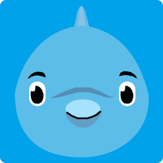
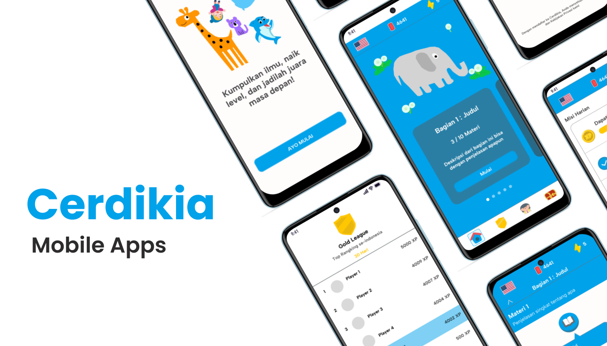
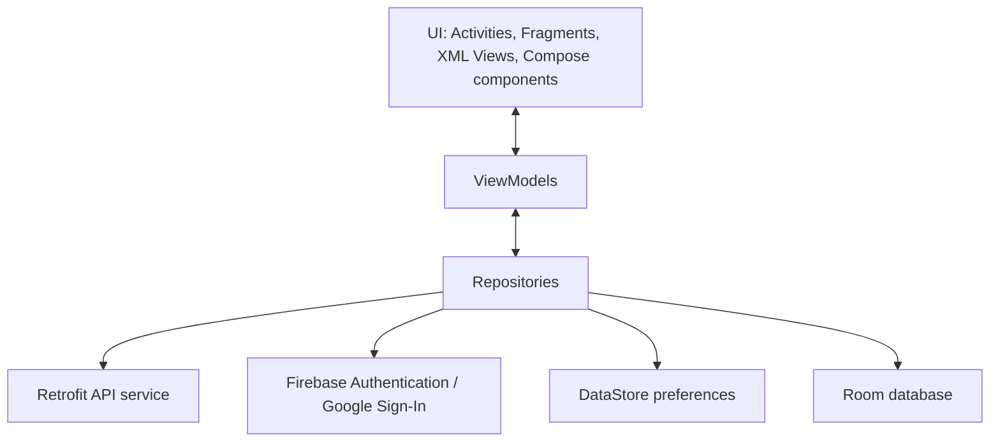
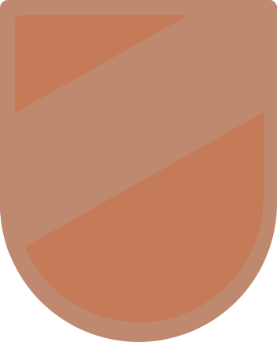
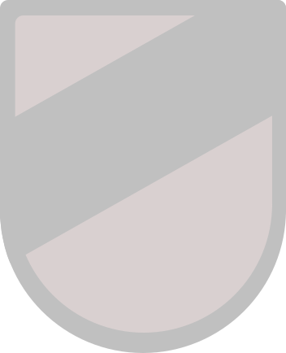
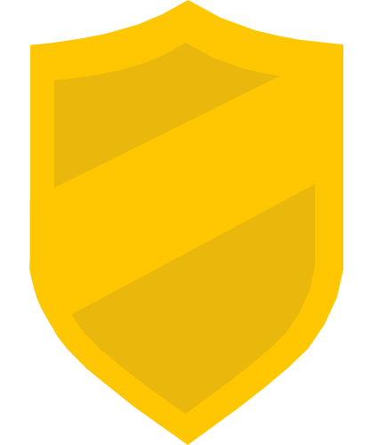
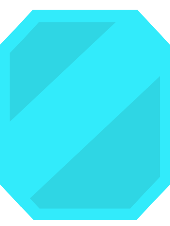

<div align="center">
  

  <p>
    
    
    
    
    
    
    
  </p>

  <h1>CerdikiaMobile</h1>
  <p>Aplikasi kuis edukasi Android untuk membantu siswa belajar, mengumpulkan XP, dan berkompetisi di papan peringkat.</p>
</div>

<p align="center">
  
</p>

## Fitur utama

- Kuis interaktif dan materi belajar berdasarkan mata pelajaran.
- Autentikasi Firebase dan Google Sign-In.
- XP, gems, misi harian, toko hadiah, dan papan peringkat.
- Retrofit untuk komunikasi dengan backend.
- Data preferensi dan sesi pengguna disimpan secara lokal dengan DataStore.
- Room tersedia untuk penyimpanan data mapel secara lokal.

## Arsitektur

Aplikasi menggunakan MVVM. UI berbasis Android Views dan Fragment, dengan Jetpack Compose untuk komponen tertentu seperti navigasi. ViewModel mengelola state dan menghubungkan UI ke repository. Repository mengatur akses ke API dan penyimpanan lokal.



## Tech stack

- **Bahasa dan build:** Kotlin 2.1.20, Gradle, Android Gradle Plugin 8.9.1, KSP.
- **Platform:** Android, `minSdk 26`, `targetSdk 35`, Java 11.
- **UI:** Android Views, XML layouts, View Binding, Jetpack Compose (Compose BOM 2025.03.01), Material Components.
- **Arsitektur dan navigasi:** MVVM, AndroidX ViewModel, Navigation Component, Safe Args.
- **Networking:** Retrofit 2.9.0, Gson converter, OkHttp Logging Interceptor.
- **Penyimpanan:** DataStore 1.1.4/1.1.6, Room 2.7.1, Protocol Buffers.
- **Auth dan layanan Google:** Firebase Authentication 23.2.0, Google Identity, Credential Manager.
- **UI pendukung:** Glide 4.16.0, Facebook Shimmer 0.5.0.

Versi pustaka dikelola di [`gradle/libs.versions.toml`](gradle/libs.versions.toml); konfigurasi SDK dan dependensi aplikasi berada di [`app/build.gradle.kts`](app/build.gradle.kts).

## Sistem ranking

League ditentukan dari XP pengguna yang tersimpan dan ditampilkan sebagai badge. Ambang berikut mengikuti implementasi di `RangkingFragment`:

| League | XP minimum | Ilustrasi |
|---|---:|---|
| Bronze | 0 |  |
| Silver | 1.000 |  |
| Gold | 2.000 |  |
| Platinum | 3.000 |  |
| Diamond | 5.000 |  |

Pengguna dengan XP kurang dari 1.000 masuk Bronze. Saat mencapai ambang berikutnya, league berubah ke tier yang sesuai. Daftar pemain dimuat dari endpoint ranking berdasarkan kelas, lalu XP pengguna saat ini dimasukkan dan daftar ditampilkan dari XP tertinggi.

## Menjalankan project

### Persyaratan

- Android Studio versi stabil terbaru.
- JDK 11 atau lebih baru.
- Android SDK API 35 (dan platform minimum API 26).
- Konfigurasi Firebase untuk aplikasi ini.

### Langkah

1. Clone repository dan buka project di Android Studio.
2. Tambahkan `google-services.json` ke direktori `app/` dari Firebase Console.
3. Sinkronkan Gradle, lalu jalankan aplikasi dari Android Studio atau gunakan:

   ```bash
   ./gradlew installDebug
   ```

Untuk build project:

```bash
./gradlew build
```

## Struktur project

```text
app/src/main/java/com/fhanafi/cerdikia/
├── data/          # Database, DataStore, model, API, mapper, repository
├── helper/        # Utilitas aplikasi
├── ui/            # Activity, Fragment, ViewModel, adapter, komponen UI
├── MainActivity.kt
├── UserViewModel.kt
└── ViewModelFactory.kt

docs/assets/       # Logo, banner showcase, dan ilustrasi league
```

## Aset dokumentasi

Gambar README disimpan di [`docs/assets/`](docs/assets/): logo Cerdikia, banner showcase, serta ilustrasi Bronze, Silver, Gold, Platinum, dan Diamond.

## Kontribusi

Silakan buat branch untuk perubahan, sertakan ringkasan yang jelas, lalu ajukan pull request.

## Lisensi

Lihat file `LICENSE` jika tersedia di repository.
